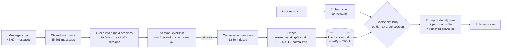

# IsaacBot

A retrieval-augmented chatbot that imitates one specific person's texting style, built from a corpus of about 46,000 personal text messages between me and my twin brother.

Instead of fine-tuning a model, IsaacBot combines a written persona profile (derived from corpus analysis) with retrieval over real past conversations, so responses are grounded in how he actually talks: message length, shorthand, emoji rate, and the way he jokes, gives advice, or backs off when someone is busy.

> **About the data.** The real messages are private and are not in this repository. This repo contains the full application code and a small **fictional** sample dataset (two invented people, "Alex" and "Sam") so you can run everything end to end. The live demo built on the real corpus is invite-only; [email me](mailto:aaron.m.underhill@gmail.com?subject=IsaacBot%20demo%20request) for access.

## How it works



**Data pipeline.** Messages are exported straight from the macOS Messages database (decoding the binary `attributedBody` field newer messages use), cleaned of iMessage artifacts with tapback reactions split out, grouped into conversational turns, and organized into distinct conversation sessions. Session boundaries were chosen by analyzing the gaps between turns (`scripts/analysis/analyze_session_thresholds.py`).

**Leak-free evaluation.** The 80/10/10 train/validation/test split is done by whole *session*, not by message, and stratified by year so every split covers 2022 through 2026. That gives 1,543 / 194 / 194 sessions. Only training sessions are indexed for retrieval, and `scripts/verify_training_only.py` checks that no validation or test session leaked into the index.

**Retrieval.** Overlapping conversation windows are embedded and stored as a normalized NumPy matrix, so cosine similarity is a single matrix-vector dot product. No vector database needed at this scale. Results are capped at one window per session so a single long conversation can't dominate the retrieved context.

**Persona profile.** A written style guide built from corpus statistics (shorthand frequency, emoji rate, use of caps, response length) and recurring behavioral patterns. It tells the model what's typical, and just as important, what to avoid (for example, using emoji far less often than a naive imitation would).

## Evaluation

`scripts/evaluate_validation.py` takes held-out validation conversations, asks the bot for the next reply, and compares it with what was actually sent. Results from v0.1 on 60 validation cases (`results/validation_summary_v0.1.json`):

| Metric | Result |
|---|---|
| Mean semantic similarity to the real reply | 0.29 |
| Mean reply length, real vs. bot | 13.3 vs. 15.6 words |
| Asks a question when the real reply did (or didn't) | 80% |
| Uses ALL CAPS when the real reply did (or didn't) | 78% |
| Emoji present when the real reply had one (or not) | 53% |
| Replies containing emoji, real vs. bot | 0% vs. 47% |
| Empty responses | 6.7% |

The bot got length, questions, and caps roughly right but badly overused emoji compared to the real person. A likely cause: retrieved examples sometimes contain emoji, and the model copies them far more often than the real person uses them. The persona profile now explicitly calibrates emoji down, and re-running this evaluation against the updated persona is the next step.

## Privacy by design

- Raw and processed messages never leave private storage; `.gitignore` blocks everything in `data/` except the synthetic sample.
- The app's "retrieved memories" debug panel is off by default (`ISAACBOT_SHOW_MEMORIES=false`) so users can't browse the corpus.
- The prompt instructs the model to use retrieved conversations as style evidence and never quote them verbatim.
- The real deployment is invite-only.

## Running it locally

```bash
git clone https://github.com/aaron-underhill/isaacbot.git
cd isaacbot
python -m venv .venv && source .venv/bin/activate
pip install -r requirements.txt

cp .env.example .env          # then add your OpenAI API key

python app/build_rag_index.py # embeds the sample conversations
streamlit run app/web.py
```

To run on your own data, point `ISAACBOT_DATA_DIR` at a private folder containing `train_windows.jsonl` and `persona.md` (see `data/sample/` for the format).

## Project structure

```
app/
  config.py                     settings, paths, model names
  build_rag_index.py            embeds training windows into the local index
  rag.py                        cosine-similarity search with per-session capping
  persona.py                    prompt assembly: rules + persona profile + retrieved examples
  web.py                        Streamlit chat interface
  chat.py                       terminal chat interface
scripts/
  data_pipeline/
    export_isaac.py             export one conversation from the macOS Messages database
    clean_imessage_artifacts.py strip iMessage artifacts, separate tapback reactions
    build_turns.py              merge consecutive messages into turns
    build_sessions.py           group turns into conversation sessions
    build_behavioral_windows.py slice sessions into overlapping windows
    sample_behavioral_windows.py
  analysis/                     corpus statistics, session-gap analysis, behavioral traits
  split_dataset.py              session-level, year-stratified train/validation/test split
  verify_training_only.py       confirms no held-out session leaked into the index
  analyze_training_surface_style.py  style statistics from the training split only
  evaluate_validation.py        held-out evaluation against real replies
results/                        split counts and evaluation metrics (no message text)
data/sample/                    fictional example data and persona profile
```

The scripts in `scripts/` run against the private corpus, so they won't run on a fresh clone. They're here to show the full process. The app in `app/` runs end to end on the sample data.

## Tech

Python · OpenAI Responses API · OpenAI embeddings · NumPy · Streamlit
